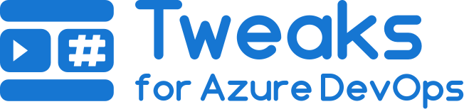

<picture>
  <source media="(prefers-color-scheme: dark)" srcset="assets/wordmark-white.svg">
  
</picture>

The features Azure DevOps forgot. A browser extension for Chrome, Edge and Firefox that adds the small things Azure DevOps lacks, each with its own switch.

The store links come with the first release.

## The tweaks

- **Work item ID and state on collapsed taskboard rows.** When a story row on the sprint taskboard is collapsed, Azure DevOps shows the title and a count of its tasks, and nothing else. This tweak puts the ID in front of the title, muted like the ID on the cards, and the state after it in bold. Two switches, one for each, both on from the start. People have asked Microsoft for this since 2020 ([Developer Community](https://developercommunity.visualstudio.com/t/Show-user-story-ID-and-state-on-taskboar/1189040)), and an Azure DevOps extension from the Marketplace cannot do it: such an extension can add hubs and widgets, but cannot change the taskboard itself. A browser extension can.

More tweaks come as they are missed. Each is a switch on the options page, so you can keep the ones you want.

## Where it works

- **The Azure DevOps cloud** at dev.azure.com and the older `*.visualstudio.com` addresses, from the moment the extension is installed.
- **Azure DevOps Server**, the on-premises product, on the options page: enter your server's address and click Add this site. The browser then asks for access to that one site, and the tweaks run there too. Remove the site on the same page to give the access back.

## Feedback

Something not working, or an idea? Use the issue forms at https://github.com/ronnidc/tweaks-for-azure-devops/issues/new/choose. The links at the bottom of the options page open the forms, or a mail for anyone who would rather not post in public, with the version and the browser filled in, which you can see and change before sending.

## Decisions

- **Your session, your server, nothing else.** The state is read from the Azure DevOps server the page comes from, through its own REST API, with the session you are already signed in with. The extension talks to no other server, has no backend and collects nothing. The IDs are already in the page.
- **One switch per tweak.** Every tweak can be turned off on the options page, which takes effect on open pages without a reload. A tweak is a folder under `core/` and a row in `core/features.ts`.
- **Access one site at a time.** The cloud is in the manifest. A server of your own has a name nobody can guess, so you add it, and the browser asks for access to that site alone (`optional_host_permissions`). Nothing else is requested at install.
- **Both taskboards from one script.** The cloud runs the New Boards Hub, Azure DevOps Server the older taskboard, with nothing in common in their markup. The script carries a profile for each and uses the one whose rows exist on the page.
- **The page's own colors.** The badges inherit the row's color and use opacity for the muted ID, so they look right on the light and the dark theme alike.
- **Plain TypeScript, no UI framework.** The content script runs in someone else's page and has to stay tiny, and the options page is too small to carry a framework.
- **WXT stays at the edges.** WXT is pre-1.0, so only `entrypoints/`, `wxt.config.ts` and `platform/browser.ts` know about it.
- **Manifest V3 in every browser**, set in `wxt.config.ts`.
- **English only.** The product it tweaks is English in most teams, and the listing is English in every store.

## Commands

| Command | Does |
|---|---|
| `npm run dev` | Starts Chrome with the extension loaded and reloads on change |
| `npm run dev:firefox` | The same in Firefox |
| `npm test` | Runs the unit tests |
| `npm run compile` | Type-checks |
| `npm run build` | Builds `.output/chrome-mv3`, which Edge loads too |
| `npm run build:firefox` | Builds `.output/firefox-mv3` |
| `npm run lint:firefox` | Runs Mozilla's linter on the Firefox build |
| `npm run zip`, `npm run zip:firefox` | Packages for the stores |

## Building from source

The store packages are built from this repository with Node 24 (see `.nvmrc`) and npm 11 on macOS. The same commands work on Linux.

```sh
npm ci
npm run build            # .output/chrome-mv3, the package for Chrome and Edge
npm run build:firefox    # .output/firefox-mv3
```

`npm run zip` and `npm run zip:firefox` write the packages to `.output/`, and the Firefox one comes with a `-sources.zip` for Mozilla's reviewers. The build is deterministic: the sources zip rebuilt in a clean folder gives output identical byte for byte to the package.

## License

Copyright 2026 Ronni Chidekel. Tweaks for Azure DevOps is free software: you can redistribute it and modify it under the terms of the GNU General Public License, version 3, see [LICENSE](LICENSE). A modified version has to be published under the same license, with its source.

The name "Tweaks for Azure DevOps" is not part of the license. As section 7 of the license allows, no rights under trademark law are granted, so a modified version goes by a name of its own. Azure DevOps is a trademark of Microsoft, and this extension is not affiliated with or endorsed by Microsoft.
